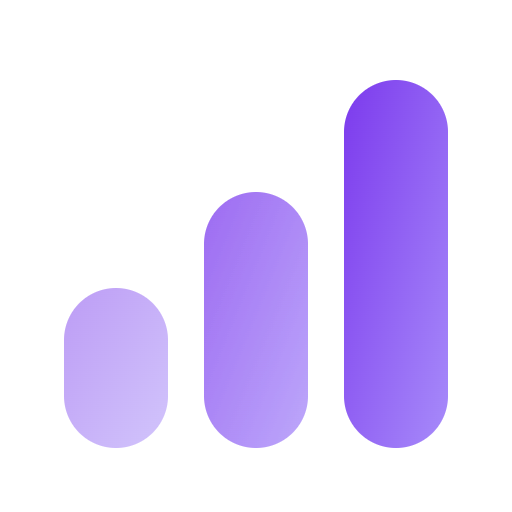
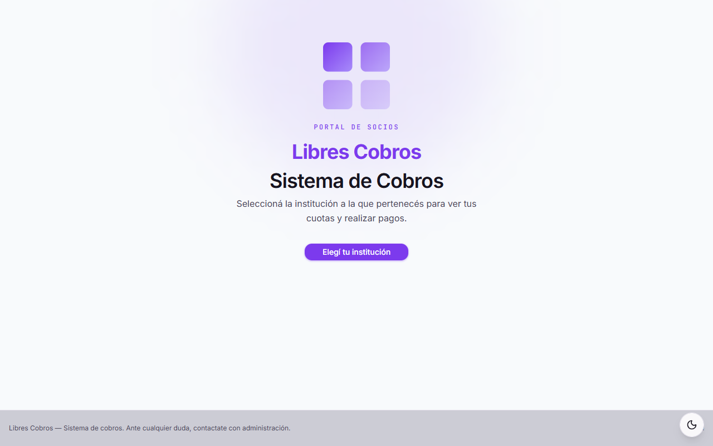
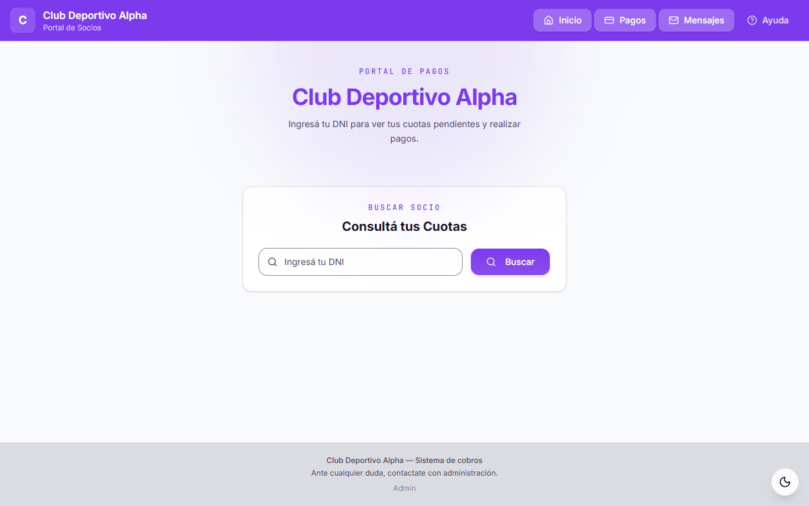
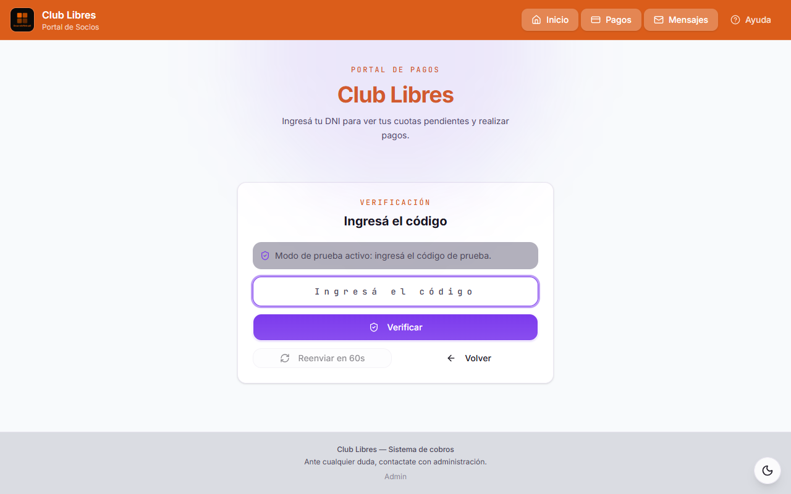
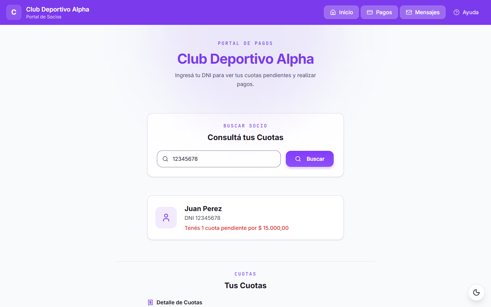
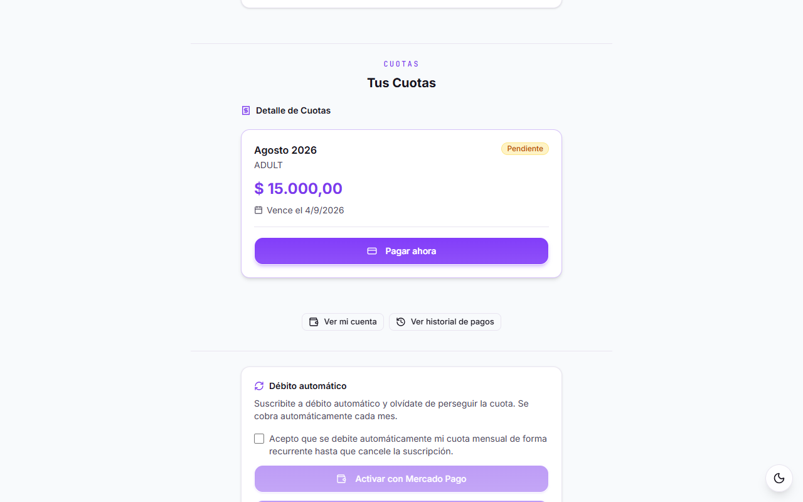
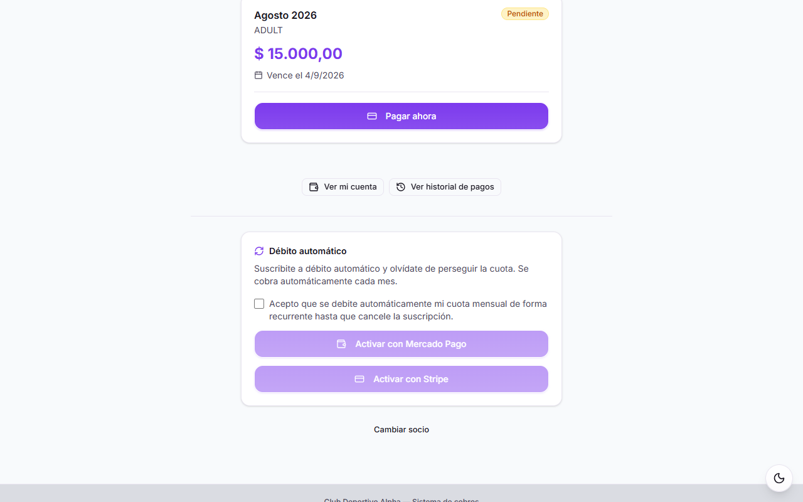
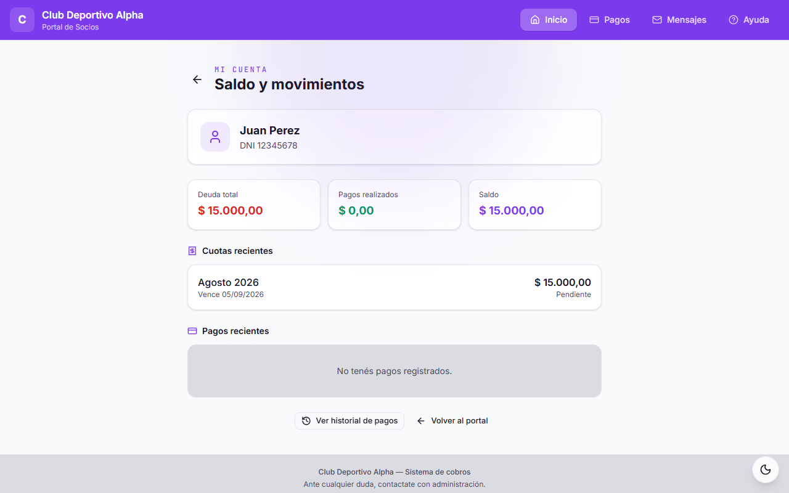
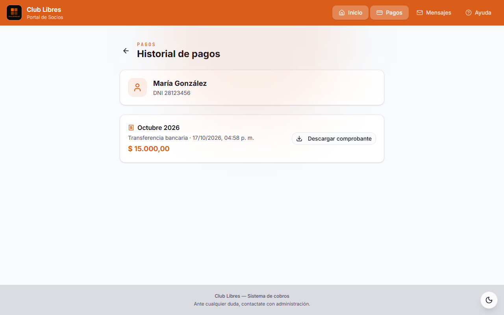
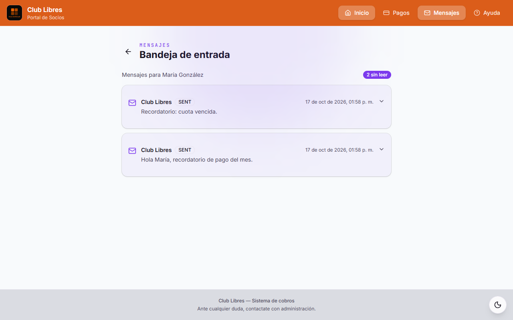

<h1 style="text-align: center;">Manual del Socio</h1>

<strong>Libres Cobros</strong> — Sistema de cobros para clubes e instituciones

Guía de uso del portal de socios Versión noviembre 2026

desarrolloweb-pdl.dev

# Manual del Socio — Libres Cobros

Guía para usar el portal de tu club: ver tus cuotas, pagarlas y gestionar tu
débito automático. Sin conocimientos técnicos — si algo no está acá, escribinos
por **Ayuda** (soporte) o preguntale a tu club.

**Contenido:**
1. [Entrá en 3 pasos](#1-entrá-en-3-pasos)
2. [Qué ves en tu panel](#2-qué-ves-en-tu-panel)
3. [Cómo pagar una cuota](#3-cómo-pagar-una-cuota)
4. [Tu comprobante](#4-tu-comprobante)
5. [Débito automático (opcional)](#5-débito-automático-opcional)
6. [Estado de cuenta e historial](#6-estado-de-cuenta-e-historial)
7. [Mensajes de tu club](#7-mensajes-de-tu-club)
8. [Cerrar sesión / Cambiar socio](#8-cerrar-sesión--cambiar-socio)
9. [Preguntas frecuentes](#9-preguntas-frecuentes)

---

## 1. Entrá en 3 pasos

1. **Entrá a tu portal** — abrí el link que te pasó tu club, o andá a la web del
   sistema y tocá **"Portal de socios"** → elegí tu institución.
   *(Si tu club es el único en el sistema, entrás directo sin elegir.)*
2. **Ingresá tu DNI** y tocá **Buscar**.
3. **Si tu club verificó el ingreso con código**, te llega un código por
   **WhatsApp** (o email) — pegalo en la pantalla y tocá **Verificar**.
   *(Si tu club todavía no activó esa seguridad, con el DNI alcanza.)*

✅ Listo: entraste a tu panel con tus cuotas.

> **Tip:** si entraste desde el link de un recordatorio de tu club, tu DNI ya
> aparece cargado — solo tenés que tocar **Buscar**.

*Paso 1 — Elegí tu institución.*

*Paso 2 — Ingresá tu DNI y tocá **Buscar**.*

*Paso 3 — Ingresá el código que recibiste y tocá **Verificar**. (Captura con el
modo de prueba de una institución; con WhatsApp activo el mensaje dice
"Si el DNI corresponde a un socio, recibirás un código".)*

---

## 2. Qué ves en tu panel

| Pantalla | Qué podés hacer ahí |
|---|---|
| **Inicio** (portal de pagos) | Ver tus cuotas pendientes y pagarlas |
| **Tus Cuotas** | Detalle de cada cuota: monto, vencimiento y estado |
| **Ver mi cuenta** | Tu saldo: cuánto debés y cuánto pagaste en total |
| **Ver historial de pagos** | Todos tus pagos con fecha, medio y estado |
| **Mensajes** | Avisos que manda tu club (recordatorios, novedades) |
| **Ayuda** | Soporte del sistema |

*Tu panel: cada cuota con su estado y, si está pendiente, el botón para pagarla.*

La barra de arriba siempre te deja moverte entre pantallas; el logo te vuelve
al inicio de tu portal.

---

## 3. Cómo pagar una cuota

1. En **Inicio**, buscá la cuota y tocá **"Pagar ahora"**.
2. **Elegí el medio de pago** que tu club tenga habilitado:
   - **Mercado Pago** o **Stripe** (tarjeta o billetera virtual) → te redirigen
     a la pantalla de pago, pagás y volvés al portal.
   - **Transferencia bancaria** → te muestra los datos del club; después de
     transferir, tu club registra el pago (o seguí las instrucciones que aparezcan).
3. Cuando el pago se confirma, ves la pantalla de confirmación con el botón
   **"Descargar comprobante"**.

*En tu cuota pendiente, tocá el botón **Pagar ahora**.*

> Los medios que ves dependen de lo que tu club tenga configurado: si no ves
> Mercado Pago, es porque tu club no lo activó — preguntale a administración.

---

## 4. Tu comprobante

- Cada pago confirmado tiene su **comprobante**, descargable desde la pantalla
  de confirmación o desde tu historial.
- Si tu club emite comprobantes fiscales, el comprobante incluye el
  **código QR de validación** y los datos del Recibo C — es tu factura.

---

## 5. Débito automático (opcional)

Que tu cuota se debite sola todos los meses, sin perseguir vencimientos.

**Para activarlo necesitás:** un **email cargado** en tu ficha (si no lo tenés,
pedile a tu club que lo agregue).

**Cómo activarlo:**
1. En tu portal, buscá la sección **"Débito automático"**.
2. Marcá el **checkbox de aceptación** (obligatorio).
3. Tocá **"Activar con Mercado Pago"** o **"Activar con Stripe"** y seguí la
   pantalla de autorización.

**Estados que puedes ver:**

| Estado | Qué significa | Qué hacer |
|---|---|---|
| **Activo** | Se debita solo cada mes | Nada |
| **Pendiente de activación** | Falta que autorices | Completá la autorización desde el email o la pantalla |
| **Falló** | El último cobro no pasó | Tocá **Reintentar** |
| **Pausado** | La suscripción está detenida | Comunicate con tu club |
| **Cancelado** | Se canceló | Tocá **Reactivar** |

También podés **cancelar** cuando quieras desde el mismo botón.

*La sección **Débito automático** aparece al final de tu panel.*

---

## 6. Estado de cuenta e historial

- **"Ver mi cuenta"** (botón debajo de tus cuotas): resumen de tu saldo actual
  y todos tus movimientos.
- **"Ver historial de pagos"**: cada pago con fecha, medio (Mercado Pago, Stripe,
  transferencia) y estado — lo que necesitás para revisar o reclamar.

*Estado de cuenta: saldo actual y movimientos.*

*Historial: cada pago con fecha, medio y botón **Descargar comprobante**.*

---

## 7. Mensajes de tu club

En **Mensajes** llegan los avisos que manda tu club: recordatorios de vencimiento
y novedades. Si tu club envía por WhatsApp, también los ves en tu WhatsApp —
esta pantalla es tu respaldo ordenado.

*Bandeja de entrada: los mensajes de tu club, con fecha y estado.*

---

## 8. Cerrar sesión / Cambiar socio

Terminaste de consultar en un **celular prestado o de una PC compartida**:

1. Tocá **"Cambiar socio"** (abajo del panel).
2. Eso cierra tu sesión y limpia tus datos de la pantalla.

**Importante:** sin esta opción, el portal guarda tu DNI en esa sesión de
navegador — siempre usá "Cambiar socio" antes de prestar el equipo.

---

## 9. Preguntas frecuentes

**No me llegó el código de verificación.**
Esperá unos minutos (caduca a los **10 minutos**). Revisá que tu club tenga tu
número de WhatsApp o email correcto. Si no llega, volvé a intentar desde la
pantalla o contactá a tu club.

**Me dice que el código es incorrecto.**
Tenés **5 intentos**; después de eso, pedí uno nuevo desde la misma pantalla.

**El sistema no encuentra mi DNI.**
Tu club te da de alta con tu DNI exacto (el de tu documento). Revisalo y
probá de nuevo; si sigue sin encontrar, contactá a tu club.

**No puedo activar el débito automático.**
Es porque no tenés email cargado en tu ficha. Pedile a tu club que lo agregue.

**No veo todos los medios de pago.**
Cada club habilita los suyos. Preguntale a administración cuáles tiene activos.

**¿Es seguro?**
Sí: además de tu DNI, si tu club lo activó entrás con un código personal que
solo llega a tu celular/email, y tu sesión cierra con "Cambiar socio".

**¿Necesito instalar algo?**
No. Funciona desde el navegador de tu celular o computadora.

---

¿Falta algo? Escribinos por **Ayuda** dentro del portal.

*Relacionado: [Manual de la Institución](./MANUAL_USUARIO.md) (para administradores) ·
[Checklist de configuración](./CHECKLIST_CONFIGURACION.md) (técnicos del club)*
